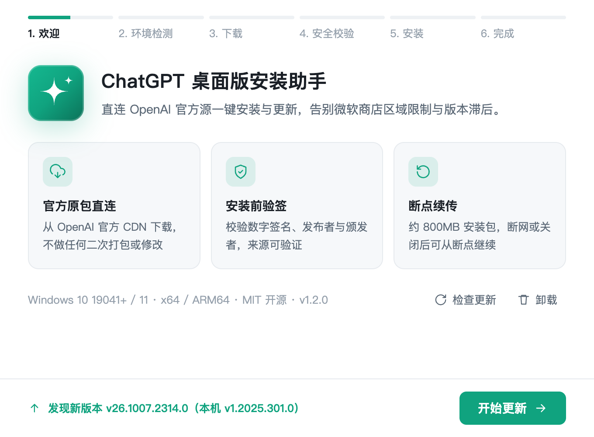

# ChatGPT 桌面版安装助手 (ChatGPT Desktop Installer)

直连 OpenAI 官方源，在 Windows 上一键**下载、验签、安装与更新**官方 ChatGPT 桌面客户端的开源小工具——**无需打开微软商店，告别区域限制与商店版本滞后**。

 -blue) 



---

## 为什么做这个工具？

在 Windows 上安装或更新官方 ChatGPT 桌面版时，国内用户经常遇到以下痛点：

1. **微软商店区域限制与版本滞后**：Windows 默认处于中国区时无法在 Microsoft Store 直接获取；即便修改地区安装后，微软商店渠道的版本推送也常常**落后于 OpenAI 官方最新版本**，无法第一时间体验新功能。
2. **微软商店本身环境问题多**：商店常出现 `0x80072EFD` 网络报错、一直卡在“正在开始下载”，而 Windows LTSC / 企业精简版系统甚至没有预装微软商店。
3. **手动下载 `.msix` 安装门槛高、易中断**：官方安装包体积已超过 **1 GB**（2026-11 实测 x64 约 1.06 GB、ARM64 约 1.17 GB），浏览器直接下载一旦网络波动就得从头再来；下载后双击安装还常因缺少 `App Installer` 或系统未开启“开发人员旁加载策略”（`0x80073CFD`）而报错失败。
4. **第三方网盘搬运包真假难辨**：网上流传的各类“网盘离线包 / 绿色安装包”无法直观确认是否被二次打包篡改，存在账号与隐私安全隐患。

---

## 我们解决了哪些问题？

### 1. 直连 OpenAI 官方 CDN，第一时间更新官方最新版
- **零中转直连**：直接从 OpenAI 官方分发源（`persistent.oaistatic.com/codex-app-prod/`，按 CPU 架构选择 x64 / ARM64 包）拉取最新安装包，不做任何二次打包、不经过任何第三方服务器。
- **云端版本对比与无损升级**：打开软件即发送一次 `HEAD` 请求，读取官方写在下载源上的版本号（`x-ms-meta-package_version`），与本机已安装版本精确比对（版本号缺失时回退到 `ETag` 对比）。发现新版时一键覆盖升级（基于 `Add-AppxPackage` 原生升级语义，**完整保留已有登录状态与本地聊天记录**）。

### 2. 1 GB+ 大包断点续传 + `If-Range` 防串包
- **随时暂停与续传**：支持手动暂停、断网重连、关闭软件后下次接着下载，实时显示下载速度与预计剩余时间（ETA）。
- **跨版本续传保护**：续传时自动携带上次记录的 `If-Range: <ETag>`。若续传期间 OpenAI 恰好发布了新版本，自动识别并重新拉取完整新版，**绝不会把新旧两个版本的分片拼成损坏包**。
- **自定义缓存目录**：支持将 1 GB+ 的安装包缓存改到 D 盘等非系统盘，避免占用 C 盘空间。

### 3. 安装前四重本地安全验签
安装前强制在本地完成四项核验，任一不通过立即拦截并拒绝安装：
1. **Authenticode 数字签名完整性**：调用系统 `Get-AuthenticodeSignature` 验证签名状态必须为 `Valid`（防传输损坏或篡改）；
2. **发布者精确匹配**：签名证书 `Subject` 必须精确匹配 OpenAI 官方发布者 ID（`CN=50BDFD77-8903-4850-9FFE-6E8522F64D5B`）；
3. **微软根证书链核验**：证书颁发者（`Issuer`）必须为 Microsoft Corporation 的 Marketplace 代码签名 CA（防伪造自签名证书）；
4. **MSIX 包内部清单校验**：直接解析 MSIX 内部 `AppxManifest.xml`，核对包身份（`OpenAI.Codex`，官方 ChatGPT 桌面版的包名）、发布者与目标 CPU 架构一致。

### 4. 智能环境诊断与疑难杂症自动修复
- **物理 CPU 原生架构识别**：通过 Win32 `IsWow64Process2` 识别机器真实的物理架构。哪怕在 Surface / 骁龙 X Elite 等 **ARM64 设备**上以 x64 模拟模式运行本安装器，也会自动匹配并下载原生 `ARM64` 版本的 ChatGPT。
- **最小权限原则 + 跨账号 UAC 无缝接力**：
  - 默认以普通用户权限安装，不弹 UAC；
  - 仅在系统禁用旁加载（`0x80073CFD`）或策略受限时，才请求一次管理员提权，自动开启系统旁加载策略并完成整机预置（`Add-AppxProvisionedPackage`）；
  - **支持企业/标准用户跨账号提权**：当普通用户借用另一个管理员账号通过 UAC 提权时，自动透传原用户的包路径与 `%LOCALAPPDATA%`，避免在管理员账户下重复下载 1 GB 安装包。
- **一键干净卸载**：内置卸载功能，可自由选择「仅卸载程序（保留登录态与聊天记录）」或「彻底卸载并清理 `%LOCALAPPDATA%` 下的应用数据」。
- **轻量原生体验**：便携版约 6 MB 单文件 `.exe`（安装版约 2 MB），零前端框架依赖；管理员检测、CPU 架构、磁盘空间查询全部调用原生 Win32 API 毫秒级完成，并完美适配 Windows 11 浅色 / 深色主题与高清任务栏图标。

### 5. 可选的定时自动更新（默认关闭）
欢迎页点击「自动更新」即可选择：
- **关闭**：只在打开本程序时检查；
- **有新版时提醒我**：每天检查一次官方版本，发现新版时弹出安装助手，由你决定是否更新；
- **自动下载并安装**：发现新版后在后台下载、四重校验并为当前用户安装；**ChatGPT 正在运行、需要管理员权限或磁盘空间不足时，不会强行处理，而是弹窗提醒**。

实现方式是为当前用户注册一个普通权限的 Windows 计划任务「ChatGPT Installer AutoUpdate」（每天 12:00，错过则开机后补查），本程序会复制一份到 `%LOCALAPPDATA%\com.github.chatgpt-installer\bin\` 供任务调用。切回「关闭」即删除任务与副本；卸载安装版时也会自动删除任务。

---

## 快速开始（普通用户）

1. 任选一种方式获取：
   - **winget**（审核通过后可用）：`winget install zktww.ChatGPTInstaller`
   - **便携版（推荐）**：到 [Releases](../../releases) 下载 `chatgpt-installer.exe`，双击即用，无需安装
   - **安装版**：到 [Releases](../../releases) 下载 `chatgpt-installer_x.x.x_x64-setup.exe`（会创建开始菜单快捷方式）
   - **PowerShell 一行启动**（用命令行下载的文件不带浏览器的下载标记，不会触发 SmartScreen 提示）：
     ```powershell
     curl.exe -L https://github.com/zktww/chatgpt-installer/releases/latest/download/chatgpt-installer.exe -o "$env:TEMP\chatgpt-installer.exe"; Start-Process "$env:TEMP\chatgpt-installer.exe"
     ```
2. 双击运行，跟随向导走完 **环境检测 → 下载 → 安全校验 → 安装** 即可；后续想升级最新版时，再次打开点击底部「检查更新 / 开始更新」即可。

> **💡 关于首次运行 Windows SmartScreen 提示**：
> 由于本项目为免费个人开源项目，暂未购买昂贵的商业 EV 代码签名证书，首次双击时 Windows 可能会弹出蓝框提示“Windows 已保护你的电脑”。你可以任选以下一种方式运行：
> - **方式一**：点击弹窗上的 **「更多信息」→「仍要运行」**；
> - **方式二（零弹窗）**：右键下载好的 `chatgpt-installer.exe` → **「属性」** → 勾选底部的 **「解除锁定 (Unblock)」** → 确定，之后双击就不会再弹提示。

---

## 开发者构建

在 Windows 10 / 11 机器上：

```powershell
# 1. 安装 Rust（https://rustup.rs）与 Node.js（用于免编译调用预编译 Tauri CLI）

# 2. 编译打包
npx @tauri-apps/cli@^2 build
```

构建产物：
- `src-tauri/target/release/chatgpt-installer.exe` — 单文件免安装版（Windows 10/11 自带 WebView2 运行时）
- `src-tauri/target/release/bundle/nsis/*.exe` — NSIS 安装向导版

> - 前端可直接用浏览器打开 `src/index.html` 进入**演示模式**预览全部交互流程。
> - 在 macOS / Linux 上可通过 `cargo clippy --target x86_64-pc-windows-gnu` 进行交叉静态检查与单元测试。
> - 诊断日志保存在 `%LOCALAPPDATA%\com.github.chatgpt-installer\installer.log`（安装失败页点击「复制诊断日志」即可一键复制）。

---

## 项目结构

```text
chatgpt-installer/
├── src/                      # 前端：Fluent 风格向导 UI（原生 HTML/CSS/JS，零第三方依赖）
│   ├── index.html            # 页面结构与内联 SVG 图标集
│   ├── style.css             # 响应式布局与浅色/深色主题变量
│   └── app.js                # 6 步状态机、Tauri IPC 与浏览器演示模式
└── src-tauri/
    ├── src/
    │   ├── main.rs           # Tauri 入口、跨账号提权参数透传、单实例锁
    │   ├── cmds.rs           # 前端 IPC 命令、异步线程封装与诊断日志
    │   ├── constants.rs      # OpenAI 官方 CDN 地址与签名证书常量
    │   ├── env_check.rs      # 系统版本、原生架构、磁盘空间与网络检测
    │   ├── download.rs       # 断点续传、If-Range 校验与云端版本对比
    │   ├── verify.rs         # Authenticode 签名/发布者/颁发者/Manifest 四重校验
    │   ├── install.rs        # MSIX 安装、旁加载自动开启、整机预置与卸载
    │   ├── elevate.rs        # RunAs 提权重启与 UAC 取消识别
    │   ├── autoupdate.rs     # 可选的定时自动更新（计划任务 + 后台检查/安装）
    │   ├── sys.rs            # 原生 Win32 API（管理员检测/原生架构/磁盘空间/任务栏大小图标）
    │   ├── ps.rs             # 无窗口 PowerShell 调用封装与安全转义
    │   ├── settings.rs       # 下载目录与已安装版本指纹持久化
    │   └── errors.rs         # HRESULT 错误码 → 中文排障提示映射
    ├── icons/                # 标准多尺寸 DIB/PNG 应用图标
    ├── windows/hooks.nsh     # NSIS 卸载钩子（删除自动更新计划任务）
    ├── capabilities/         # Tauri v2 最小权限配置
    └── tauri.conf.json
```

---

## 常见错误码速查

| 错误码 | 含义 | 自动处理 / 解决方式 |
| :--- | :--- | :--- |
| `0x80073D02` | ChatGPT 正在运行中 | 完全退出已打开的 ChatGPT（含右下角托盘图标）后点「重试」 |
| `0x80073CFD` | 系统未开启应用旁加载 | 点击「继续」，安装器会自动请求一次管理员权限开启旁加载并继续安装 |
| `0x800B0109` | 签名证书链不受信任 | 安装包损坏或系统根证书缺失，点「重试」会自动清理坏包并重新下载 |
| `0x80073D28` | 策略要求管理员权限 | 点击「继续」或右键以管理员身份运行 |
| `NEED_ELEVATION` | 当前操作需要管理员权限 | 点击页面按钮，程序会自动提权重启并无缝续跑当前步骤 |
| `UAC_CANCELLED` | 取消了 UAC 权限确认 | 点击「重试」并在系统弹窗中点「是」 |

---

## 隐私与安全声明 (Privacy Policy)

**本程序承诺绝不向任何第三方或开发者服务器上传、收集任何用户数据。**  
*(This program will not transfer any information to other networked systems unless specifically requested by the user or the person installing or operating it.)*

- **纯本地运行**：本工具无任何后端服务器、无账号体系、无统计埋点、无遥测回传。
- **网络请求完全透明**：程序仅在用户触发「检查更新」、「环境检测」或「下载安装包」时，直接连接 OpenAI 官方 CDN（`https://persistent.oaistatic.com/codex-app-prod/` 下的 `ChatGPT-x64.msix` / `ChatGPT-arm64.msix`，整机预置时另取 `ChatGPT-License.xml`）。开启「定时自动更新」后，计划任务每天会做一次同样的版本检查。
- **非官方声明**：本项目为独立开源工具，与 OpenAI 及 Microsoft 无任何隶属关系；安装完成后使用 ChatGPT 仍需登录你自己的 OpenAI 账号。

---

## 开源协议

本项目基于 [MIT License](LICENSE) 开源，可自由使用、修改与分发。
