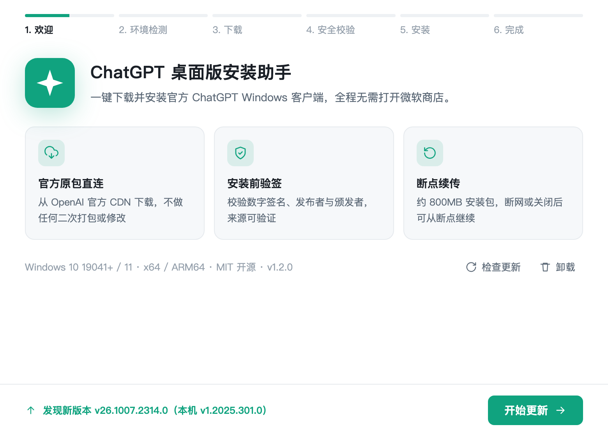

# ChatGPT 安装助手

Windows 上一键下载并安装 **官方 ChatGPT 桌面版** 的开源小工具。全程无需打开微软商店。

 



## 它做什么

1. **环境检测** — 系统版本、CPU 原生架构（ARM64 设备自动匹配 ARM64 包）、磁盘空间、官方 CDN 连通性，装之前先把坑排掉
2. **下载** — 从 OpenAI 官方 CDN 直连下载 MSIX 安装包，断点续传，实时显示速度与剩余时间
3. **安全校验** — 校验数字签名、发布者、证书颁发者、包身份，确认是官方版本才继续
4. **安装** — 优先免提权为当前用户安装；必要时才请求一次 UAC，并整机预置
5. **检查更新** — 欢迎页自动对比云端版本，有新版一键重新下载覆盖安装（Add-AppxPackage 原生升级语义）

界面跟随系统浅色 / 暗色主题。

## 信任说明（请先读）

- 安装包全部来自 OpenAI 官方 CDN（`persistent.oaistatic.com`），本程序**不做任何二次打包、不修改、不托管**任何二进制文件
- 校验依据是 **Authenticode 数字签名**（发布者精确匹配 `CN=50BDFD77-8903-4850-9FFE-6E8522F64D5B`，颁发者须为 Microsoft Corporation 的 Marketplace CA），不是哈希——官方地址是固定 latest 指针，版本会变，签名才是可信依据
- **纯客户端，零服务端**：下载直连官方，校验安装都在本地，不设账号、不收集任何数据、不回传
- 使用 ChatGPT 仍需登录你自己的 OpenAI 账号
- 与 OpenAI / Microsoft 无任何隶属关系，非官方项目

## 快速开始（普通用户）

1. 到 [Releases](../../releases) 下载 `chatgpt-installer.exe`（单文件免安装，双击即用，推荐）
   - 备选：`ChatGPT 安装助手_x.x.x_x64-setup.exe`（NSIS 安装向导版，会写入开始菜单与系统卸载列表，适合偏好"正式安装"的用户）
   - 两个二选一即可，不用都下
2. 双击运行，跟着向导走完 6 步即可
3. 首次启动 Windows 可能会弹 SmartScreen（未购买代码签名证书所致），点"更多信息 → 仍要运行"

## 开发者构建

需要一台 Windows 机器：

```powershell
# 1. 安装 Rust（https://rustup.rs）与 Node.js（用于免编译获取 Tauri CLI）

# 2. 构建
npx @tauri-apps/cli@^2 build
```

产物二选一：
- `src-tauri/target/release/chatgpt-installer.exe` — 裸 exe，单文件免安装（Win10/11 自带 WebView2），直接分发这个即可
- NSIS 安装包（`target/release/bundle/nsis/`）— 传统安装向导形态

> 前端可直接用浏览器打开 `src/index.html` 进入**演示模式**（假数据）预览全部界面。
> Rust 部分在 Linux/macOS 上可用 `cargo check --target x86_64-pc-windows-gnu` 做交叉检查，
> 完整编译与真机测试必须在 Windows 上完成。推送到 main / PR 时 CI 会自动跑 fmt、clippy 与单元测试。

### 发布

1. 同步修改 `src-tauri/Cargo.toml` 与 `src-tauri/tauri.conf.json` 的 `version`
2. 打 tag `vX.Y.Z` 并推送，CI 校验版本一致后自动构建并创建 Release

诊断日志位于 `%LOCALAPPDATA%\com.github.chatgpt-installer\installer.log`（失败页「复制诊断日志」即复制此文件末尾内容）。

## 项目结构

```
chatgpt-installer/
├── src/                      # 前端：向导 UI（零依赖，浏览器打开即演示模式）
│   ├── index.html            # 页面结构 + SVG 图标
│   ├── style.css             # 设计变量 / 浅色暗色主题
│   └── app.js                # 步骤流转 + Tauri IPC + 演示数据
└── src-tauri/
    ├── src/
    │   ├── main.rs           # Tauri 入口、提权重启参数、单实例
    │   ├── cmds.rs           # 前端 IPC 命令、诊断日志
    │   ├── constants.rs      # 官方下载地址与包身份常量
    │   ├── env_check.rs      # 环境检测
    │   ├── download.rs       # 断点续传下载、云端版本对比
    │   ├── verify.rs         # 签名/发布者/颁发者/包身份校验
    │   ├── install.rs        # 安装 / 卸载
    │   ├── elevate.rs        # 提权重启（UAC 结果回传）
    │   ├── sys.rs            # Win32 API：管理员 / 原生架构 / 磁盘空间
    │   ├── ps.rs             # PowerShell 调用与命令行引用
    │   ├── settings.rs       # 下载目录与安装记录
    │   └── errors.rs         # 错误码 → 中文说明映射
    ├── capabilities/         # Tauri 2 权限配置
    └── tauri.conf.json
```

## 常见错误码

| 错误码 | 含义 | 解法 |
|---|---|---|
| `0x80073D02` | 应用正在运行 | 完全退出 ChatGPT（含托盘）后重试 |
| `0x80073CFD` | 旁加载被禁用 | 以管理员身份运行，程序自动放行 |
| `0x800B0109` | 签名不受信任 | 包损坏，点「重试」会删除后重新下载 |
| `0x80073D28` | 需要管理员权限 | 右键以管理员身份运行 |
| `NEED_ELEVATION` | 需要提权 | 点「继续」，程序自动提权重启继续 |
| `UAC_CANCELLED` | 系统权限确认被取消 | 点「重试」再次请求；非管理员账号请联系管理员 |

## 路线图

- [ ] `PackageManager` 原生 API 安装，拿真实百分比进度（v1 用社区验证的 `Add-AppxPackage` 路线）
- [ ] 多下载源测速自动切换（官方直连 / 备用镜像）
- [ ] 安装器自身自动更新（Tauri updater + GitHub Release）
- [ ] 英文界面

## 协议

MIT — 可自由使用、修改、分发（含商业用途），详见 [LICENSE](LICENSE)。
