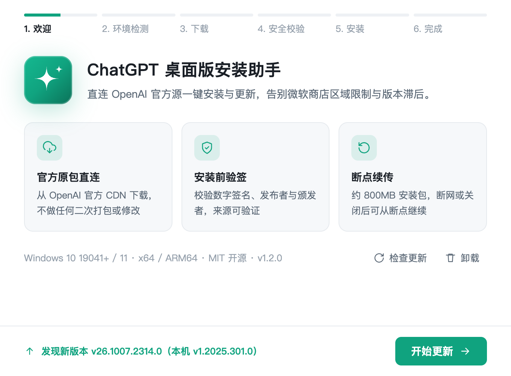

# 告别微软商店锁区与版本滞后：我用 Rust + Tauri 写了一个轻量的 ChatGPT Windows 官方桌面版安装与更新助手

> **开源仓库**：[https://github.com/zktww/chatgpt-installer](https://github.com/zktww/chatgpt-installer)  
> **最新版下载**：[GitHub Releases](https://github.com/zktww/chatgpt-installer/releases)  
> **协议**：MIT 开源 · 纯客户端零服务端 · 支持 Windows 10 / 11（x64 & ARM64）

---

## 一、为什么要做这个小工具？

OpenAI 早就推出了 Windows 原生桌面版 ChatGPT（支持 `Alt + Space` 全局快捷键呼出、截图提问、伴随窗口、高级语音模式等），体验比网页版顺手得多。

但在国内 Windows 环境下，想要**装上它**并**及时保持在官方最新版本**，却处处是坑：

1. **微软商店锁区 + 版本推送严重滞后**  
   Windows 默认处于中国区时，Microsoft Store 里根本搜不到 ChatGPT；即便手动把系统区域切到美区装上了，**微软商店渠道的版本更新也经常比 OpenAI 官方发布慢半拍**，官方出了新特性，商店里却迟迟刷不出更新。
2. **微软商店本身环境问题频发**  
   不少用户的 Microsoft Store 常年报 `0x80072EFD`、一直卡在“正在开始下载”；而使用 Windows 10/11 LTSC 或企业精简版系统的用户，电脑里甚至根本没有微软商店。
3. **手动下载官方 `.msix` 安装门槛高、容易踩坑**  
   OpenAI 官方 MSIX 安装包体积已超过 **1 GB**，用浏览器直接裸下，一旦网络波动断连就得从 0% 重新下；好不容易下完双击安装，又可能遇到缺少 `App Installer`、或者系统未开启开发人员旁加载策略（报错 `0x80073CFD`），普通用户看着一串十六进制错误码根本无从下手。
4. **第三方网盘搬运包不敢装**  
   网上有很多人分享所谓“网盘离线安装包 / 绿色版”，但对于涉及账号和隐私的 AI 客户端来说，没有经过数字签名校验的搬运包谁也不敢轻易双击。

为了彻底解决这些问题，我用 **Rust + Tauri v2** 开发并开源了这款 **「ChatGPT 桌面版安装助手」** —— 一个约 **6 MB**、双击即用的单文件小工具，帮你直接从 OpenAI 官方 CDN 下载、验签、安装并随时更新到最新官方桌面版。



---

## 二、它能帮你解决什么问题？

### 1. 直连 OpenAI 官方源，第一时间无损更新最新版
- **零中转直连**：程序内置 OpenAI 官方桌面端分发 CDN 地址（`persistent.oaistatic.com/codex-app-prod/`，x64 / ARM64 分别取对应安装包），所有字节直接从官方服务器拉取到本地，**不做任何二次打包、不经过任何第三方中转**。
- **秒级检测云端新版**：打开工具后发送一次 HTTP `HEAD` 请求，读取官方写在下载源上的版本号（`x-ms-meta-package_version`），与本机已安装版本精确比对。一旦发现 OpenAI 发了新版本，底部直接提示 **「发现新版本 → 开始更新」**，基于系统 `Add-AppxPackage` 原生升级机制覆盖安装，**完整保留你的登录状态与本地聊天记录**。

### 2. 1 GB+ 大包断点续传 + `If-Range` 防串包
- **随时暂停与续传**：支持手动暂停、断网重连、甚至关闭软件或重启电脑后从上次的进度继续下载，界面实时显示下载速度与预计剩余时间（ETA）。
- **跨版本续传防损坏**：如果今天下了一半暂停，明天继续下载时恰逢 OpenAI 发布了新版本怎么办？工具在续传时会自动携带 `If-Range: <ETag>` 请求头——一旦检测到官方包已更新，会自动丢弃旧分片并重拉完整新版，**绝不会把新旧两个版本的二进制流拼成损坏包**。
- **支持更改下载目录**：C 盘空间紧张？在下载页点击「更改…」即可调用系统原生文件夹选择器，把 1 GB+ 的安装包缓存放到 D 盘或其他分区。

### 3. 安装前「四重本地安全验签」，拒绝任何篡改包
在调用系统安装接口前，安装助手会在本地强制执行四道安全校验，任何一项不通过都会立即拦截并告警：
1. **Authenticode 签名完整性**：调用系统 `Get-AuthenticodeSignature` 确认文件签名状态必须为 `Valid`（防下载损坏或中间人篡改）；
2. **发布者精确匹配**：严格解析证书 DN，要求 `Subject` 的 `CN` 必须精确匹配 OpenAI 官方发布者标识（`CN=50BDFD77-8903-4850-9FFE-6E8522F64D5B`）；
3. **微软根证书链核验**：证书颁发者（`Issuer`）必须来自 Microsoft Corporation 的 Marketplace 代码签名 CA（防止伪造同名自签名证书绕过检测）；
4. **MSIX 内部清单核验**：直接解析 MSIX 包内的 `AppxManifest.xml`，核对 `OpenAI.Codex`（官方 ChatGPT 桌面版的包名）包身份与目标 CPU 架构一致。

### 4. 智能环境诊断与疑难杂症自动修复
为了不让用户在安装到最后一步时才报错卡住，工具把所有常见坑都做成了自动化处理：
- **前置环境体检**：下载前先检查系统版本（需 Windows 10 19041+ / Windows 11）、目标盘剩余空间、以及 OpenAI 官方 CDN 连通性。
- **物理 CPU 原生架构识别**：通过 Win32 原生 API `IsWow64Process2` 检测机器真实的物理 CPU 架构——哪怕你使用的是 Surface Pro 或骁龙 X Elite 等 **ARM64 笔记本**，并以 x64 兼容模拟模式运行本安装器，它也能精准识别并为你安装原生 `ARM64` 架构的 ChatGPT。
- **最小权限原则 + 跨账号 UAC 无缝接力**：
  - 默认以普通用户身份静默安装，不弹 UAC；
  - 只有当系统禁用了旁加载（`0x80073CFD`）或组策略受限时，才会请求一次管理员权限，自动开启系统旁加载策略并完成整机预置（`Add-AppxProvisionedPackage`）；
  - **支持企业/标准用户跨账号提权**：如果当前是标准用户，弹 UAC 时输入了另一个管理员账号的密码，提权后的进程会自动继承原用户的安装包目录与配置路径，不会在管理员账户下白白重下一遍 1 GB 安装包。
- **一键干净卸载**：欢迎页自带「卸载」功能，可自由选择 **「仅卸载程序（保留登录态与聊天记录）」** 或 **「彻底卸载并清理 `%LOCALAPPDATA%` 下的应用数据」**。

### 5. 极速轻量，原生 Windows 11 Fluent 体验
- **零前端框架依赖**：前端采用原生 HTML + CSS + JS 编写，后端基于 Rust + Tauri v2，便携版约 6 MB，启动无需等待。
- **毫秒级环境响应**：管理员身份检测（`IsUserAnAdmin`）、CPU 原生架构（`IsWow64Process2`）、磁盘剩余空间（`GetDiskFreeSpaceExW`）全部直接调用 Win32 API，彻底告别连开多个 PowerShell 进程带来的 1～2 秒黑框/冷启动卡顿。
- **自适应浅色 / 深色模式**：自动跟随 Windows 系统主题切换，内置常见错误码中文排障提示与一键复制诊断日志功能。

### 6. 可选的定时自动更新
欢迎页点「自动更新」可选择 **关闭 / 有新版时提醒我 / 自动下载并安装**。开启后通过普通权限的 Windows 计划任务每天检查一次官方版本；自动安装模式下如果 ChatGPT 正在运行，不会强行关闭，而是弹窗提醒。

---

## 三、快速上手

### 方式零：winget（审核通过后可用）
```powershell
winget install zktww.ChatGPTInstaller
```

### 方式一：下载单文件版直接运行（推荐）
1. 前往 [GitHub Releases](https://github.com/zktww/chatgpt-installer/releases) 下载最新版的 **`chatgpt-installer.exe`**（单文件免安装版，双击即用）；
2. 双击运行，跟随向导走完 **环境检测 → 下载 → 安全校验 → 安装** 即可；
3. 以后想检查或升级新版本时，再次双击打开，点击右下角 **「开始更新」** 即可一键升级到 OpenAI 官方最新版。

> **💡 小贴士（跳过 Windows SmartScreen 提示）**：  
> 由于这是个人免费开源项目，暂未购买昂贵的商业 EV 代码签名证书，首次从浏览器下载双击时若弹出 Windows SmartScreen 蓝框，点 **「更多信息 → 仍要运行」** 即可；或者右键 `chatgpt-installer.exe` → **属性** → 勾选底部 **「解除锁定 (Unblock)」** 后确定，即可零弹窗运行。

### 方式二：PowerShell 一行命令启动（天然无 SmartScreen 弹窗）
在 Windows 终端（PowerShell）中复制粘贴以下任一命令回车，即可自动拉取并启动安装助手（不会触发浏览器下载标记弹窗）：

```powershell
curl.exe -L https://github.com/zktww/chatgpt-installer/releases/latest/download/chatgpt-installer.exe -o "$env:TEMP\chatgpt-installer.exe"; Start-Process "$env:TEMP\chatgpt-installer.exe"
```

---

## 四、完全开源与隐私承诺

作为一款辅助安装工具，**可信与透明**是底线：
- **100% 开源可审计**：全部 Rust 与前端源码公开在 GitHub，且所有 Release 安装包均由 [GitHub Actions](https://github.com/zktww/chatgpt-installer/blob/main/.github/workflows/build-windows.yml) 从公开源码自动编译产出，杜绝暗箱操作。
- **零服务端、零遥测**：本工具没有任何后端服务器，不收集任何用户信息、无统计埋点、无日志上传，唯一的网络请求就是直连 OpenAI 官方 CDN。

如果你也受困于微软商店锁区、报错或 ChatGPT 桌面版更新滞后，欢迎试用！如果觉得这个小工具帮到了你，欢迎去 GitHub 点个 **Star ⭐** 支持一下（攒够社区 Star 后我们就能申请下开源基金会的免费代码签名证书，让大家彻底告别 SmartScreen 弹窗）：

👉 **GitHub 仓库地址**：[https://github.com/zktww/chatgpt-installer](https://github.com/zktww/chatgpt-installer)
